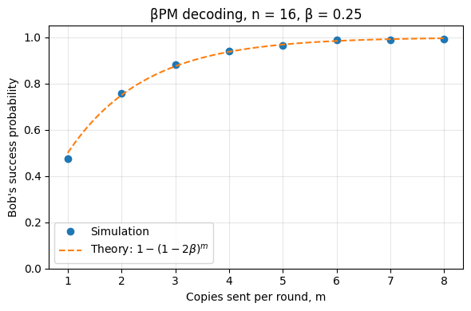
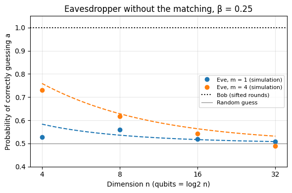
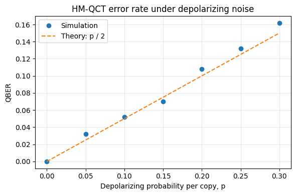
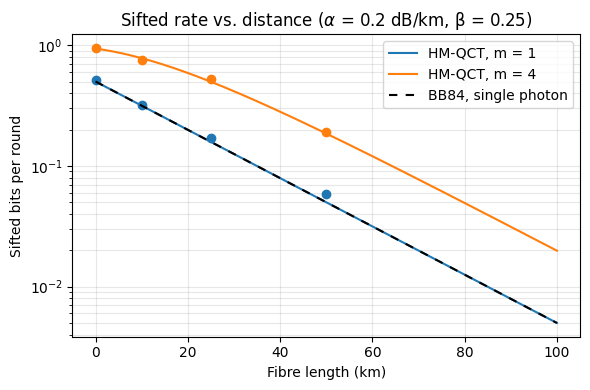

# Hidden-Matching Hybrid QKD in Qiskit

A simulation of HM-QCT, a hybrid quantum key distribution protocol built on the Hidden Matching problem ([Mazzoncini et al., *Quantum* 9, 1862, 2025](https://doi.org/10.22331/q-2025-09-24-1862)).

In HM-QCT, Alice encodes an n-bit string into a log₂(n)-qubit state and may send several copies of it. The information Bob needs to measure correctly (a matching on n vertices) is sent under classical encryption, which is assumed to outlast any eavesdropper's quantum memory. Bob uses the copies to decode reliably, while an eavesdropper who must measure without the matching learns little.

This repository implements the protocol end to end, from single circuits to a shared secret key, and checks each step against theory.

## Contents

| Notebook | What it does |
| --- | --- |
| `01_bb84_baseline.ipynb` | BB84 with an intercept-resend eavesdropper, used as a baseline |
| `02_hidden_matching.ipynb` | Hidden Matching circuit, βPM decoding with m copies, eavesdropper without the matching |
| `03_hmqct_key_exchange.ipynb` | Full protocol: AES-256-GCM layer, lossy and noisy channel, sifting, error correction, privacy amplification |

## Key results

| | |
| --- | --- |
|  |  |
| Bob's success with m copies follows 1 − (1 − 2β)^m | Eve's guessing probability approaches 1/2 as n grows |
|  |  |
| QBER under depolarizing noise follows p/2 | Multiple copies raise the sifted rate over lossy fibre |

The full pipeline (n = 32, m = 4, 2,000 rounds, 2% QBER) produces identical keys for Alice and Bob after error correction and privacy amplification.

## How the Hidden Matching measurement is implemented

1. Alice applies H to every qubit, then a `DiagonalGate` with entries (−1)^{x_i}.
2. Bob applies a permutation unitary that maps each matched pair (i, j) to neighbouring basis states (2t, 2t+1).
3. A Hadamard on qubit 0, then measurement of all qubits: the upper qubits give the edge index t and qubit 0 gives x_i ⊕ x_j.

## Running

The notebooks run on Google Colab (File → Open notebook → GitHub) or locally:

```bash
pip install -r requirements.txt
jupyter notebook notebooks/
```

Each notebook runs in under a minute.

## Limitations

- The eavesdropper is a single heuristic attack, so final key lengths are illustrative. A security claim requires the general bound proved in the paper.
- Figure 5 compares sifted rates, not secret key rates.
- Simulations are limited to n ≤ 32 (5 qubits).
- Detector imperfections, finite-size effects and classical-channel authentication are not modelled.

## Report

A short write-up of the methods and results is in `report/`.

## References

1. F. Mazzoncini, B. Bauer, P. Brown and R. Alléaume, "Hybrid Quantum Cryptography from Communication Complexity," *Quantum* 9, 1862 (2025).
2. Z. Bar-Yossef, T. S. Jayram and I. Kerenidis, "Exponential separation of quantum and classical one-way communication complexity," *Proc. 36th ACM STOC* (2004).
3. C. H. Bennett and G. Brassard, "Quantum cryptography: Public key distribution and coin tossing" (1984).
